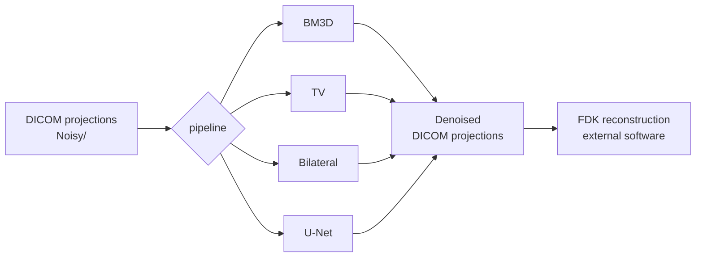

# DBT Projection Denoising

**Denoising of digital breast tomosynthesis (DBT) projections before reconstruction.**
Four methods compared, the same DICOM → DICOM interface, a single environment.

| Method | Type | Role |
|---|---|---|
| **BM3D** | block matching + 3D collaborative filtering (OpenCV `xphoto`) | main method |
| **Residual U-Net** | noise-level-conditioned network (FFDNet style), PyTorch | main method |
| Total Variation | Chambolle, scikit-image | baseline |
| Bilateral filter | scikit-image | baseline |

Parameters and checkpoint are those of the final configuration, tuned on a phantom and on clinical cases.

---

## How it works



Denoising is applied **to the individual projections**, not to the reconstructed volume. Each
method reads the DICOM projections and writes DICOMs back with the header of the original
(MONOCHROME1, 16 bit, new `SOPInstanceUID`), ready to be passed to the reconstruction software.

Some design choices:

- **Noise-anchored parameters.** TV and bilateral do not use fixed thresholds. Their parameter
  is a multiple of the relative noise `σ_rel`, estimated on the central projection of each
  acquisition (MAD of the differences between adjacent rows, inside the breast only). This way
  the same coefficient, tuned on the phantom, also holds on clinical cases.
- **Conditioned U-Net.** The network takes the image and a constant channel with the noise
  level. The denoising strength (`level`) is set at inference time, without retraining.
- **Realistic synthetic noise.** There are no clean/noisy pairs, so the network is trained on
  mammograms with noise generated on the fly. The noise grain (NPS) is measured on a real
  tomosynthesis projection with `tools/tomo_noise.py --nps` and copied into the notebook as
  `NPS_RADIAL`. The amplitude follows a model with a constant (read-out) component and a
  signal-dependent one.
- **One core per method.** The pipeline and the standalone versions call the same functions,
  so they produce the same files.

---

## Quick start

```bash
git clone https://github.com/marcomiozza/Tomo-Denoising.git
cd Tomo-Denoising

# system dependencies for BM3D
sudo apt install build-essential cmake libopencv-dev libopencv-contrib-dev

./setup.sh                 # creates .venv and builds BM3D (CPU torch)
# ./setup.sh --gpu         # or torch with CUDA
```

Then put an acquisition in `pipeline/input/` and run the pipeline:

```
pipeline/input/case01/
├── MAMMO_case01_R-MLO.dcm        (optional, only copied)
└── Noisy/
    ├── case01_R-MLO_Noisy_proj_001.dcm
    ├── ...
    └── case01_R-MLO_Noisy_proj_011.dcm
```

```bash
pipeline/run.sh case01 --methods all         # all methods
pipeline/run.sh case01 --methods bm3d,unet   # only some
pipeline/run.sh case01                        # interactive menu
pipeline/run.sh /path/case -o /path/output --methods tv
```

Results in `pipeline/output/case01/`:

```
case01/
├── MAMMO_case01_R-MLO.dcm
├── Noisy/   case01_R-MLO_Noisy_proj_001.dcm ...
├── Bm3d/    Bm3d_case01_R-MLO_proj_001.dcm ...
├── Tv/      Tv_case01_R-MLO_proj_001.dcm ...
├── Bl/      Bl_case01_R-MLO_proj_001.dcm ...
└── Unet/    Unet_case01_R-MLO_proj_001.dcm ...
```

---

## Running a single method

Each method has its own command line. The input can be a case folder, a folder of `.dcm`
files or a single file.

```bash
.venv/bin/python methods/bm3d/bm3d.py      <input> -o <output> [--config file.json]
.venv/bin/python methods/tv_bl/tv_bl.py tv <input> -o <output> [--k 0.12]
.venv/bin/python methods/tv_bl/tv_bl.py bl <input> -o <output> [--k 3.2]
.venv/bin/python methods/unet/unet.py      <input> -o <output> [--level 0.003] [--ckpt file.pt]
```

Or from Python:

```python
from pathlib import Path
from methods.dicom_io import find_projections
from methods.tv_bl import tv_bl
from methods.unet import unet

proj = find_projections("pipeline/input/case01")
tv_bl.denoise("bl", proj, Path("output/Bl"))
unet.denoise(proj, Path("output/Unet"), level=0.003)
```

---

## Parameters

These are the values of the final configuration. They can be changed from the command line or in the files listed.

| Method | Parameter | Value | Where |
|---|---|---|---|
| BM3D | strength `h` (`PARAM_SIGMA_DEFAULT`) | 3374 | `methods/bm3d/config.json` |
| | group / search window / block step | 32 / 8 / 2 | |
| | `BETA` (Kaiser window) | 0.0024 | |
| TV | `weight` | 0.12 · σ_rel | `methods/tv_bl/tv_bl.py` |
| | max iterations | 40 | |
| Bilateral | `sigma_color` | 3.2 · σ_rel | `methods/tv_bl/tv_bl.py` |
| | `sigma_spatial` | 1 | |
| U-Net | `level` | 0.003 | `methods/unet/unet.py` |
| | checkpoint | `best.pt` (epoch 55) | `methods/unet/checkpoints/` |

The BM3D parameters come from an Optuna tuning on a synthetic ground truth. The TV and
bilateral coefficients come from the phantom sweep (`tools/sweep_tvbl.py`), chosen visually
on the reconstructions.

---

## Training the U-Net

Training lives in a notebook meant for **Google Colab** with a GPU:

1. upload `colab/Unet.ipynb` to Colab and pick a GPU runtime
2. put the mammograms (`.dcm`) in `MyDrive/dataset/`
3. run the cells in order. Checkpoints, logs and masks go to `MyDrive/resunet/`,
   and training resumes on its own from the last save if the session drops

The details (architecture, synthetic noise, cell order, metrics) are in
[`colab/GUIDE.md`](colab/GUIDE.md) and [`colab/noise_model.md`](colab/noise_model.md). The
training log of the released model is in `colab/logs/training_log.csv`. The train/val/test
split is generated and saved by the notebook on its first run.

To use a checkpoint you trained yourself:

```bash
.venv/bin/python methods/unet/unet.py <input> -o <output> --ckpt /path/best.pt
```

---

## Layout

```
.
├── setup.sh               environment + BM3D build
├── requirements.txt
├── methods/
│   ├── dicom_io.py        DICOM I/O and σ_rel estimate, shared by all methods
│   ├── bm3d/              bm3d.py, bm3d.cpp, CMakeLists.txt, config.json
│   ├── tv_bl/             tv_bl.py
│   └── unet/              unet.py, checkpoints/
├── pipeline/              run.sh, denoise_pipeline.py, input/, output/
├── colab/                 training notebook, guide, log
└── tools/
    ├── sweep_tvbl.py      TV/BL variants at several values of k
    ├── tomo_noise.py      noise measurement (NPS) and tomo-like synthetic noise
    └── compare.py         pixel-by-pixel comparison of two DICOM folders
```

---

## Reproducibility

The pipeline outputs were compared pixel by pixel with the reference results. TV, bilateral
and U-Net match exactly. BM3D matches except for rare, tiny differences, because OpenCV's
parallel block matching is not fully deterministic.

To repeat the check against your own reference:

```bash
.venv/bin/python tools/compare.py pipeline/output/case01/Tv /path/reference/Tv
```

---

## Notes

- **Data.** Clinical acquisitions are not included in the repository. The code expects DICOM
  tomosynthesis projections, 11 per acquisition in the cases tested.
- **Model weights.** `.pt` files are not versioned. `best.pt` must be downloaded separately
  and placed in `methods/unet/checkpoints/`.
- **Timing.** On CPU the U-Net takes about 45 s per projection, BM3D and the filters much less.
- **Why a C++ binary.** `cv::xphoto::bm3dDenoising` is not included in the OpenCV pip
  packages, so BM3D is built against the system OpenCV. If the build fails, the other three
  methods still work.

## Author

Marco Miozza
